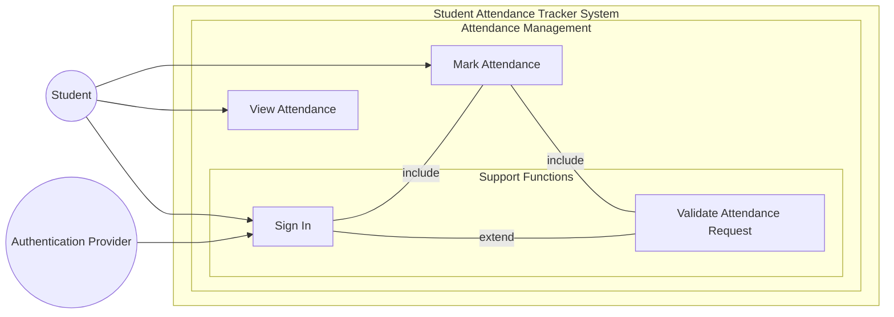
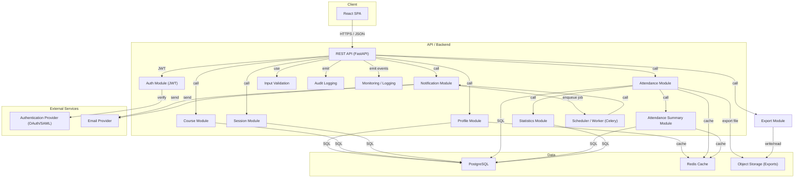
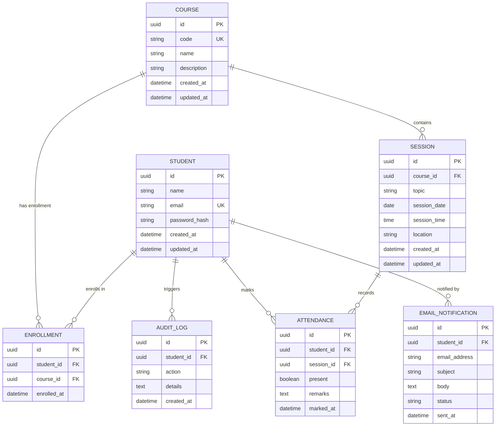
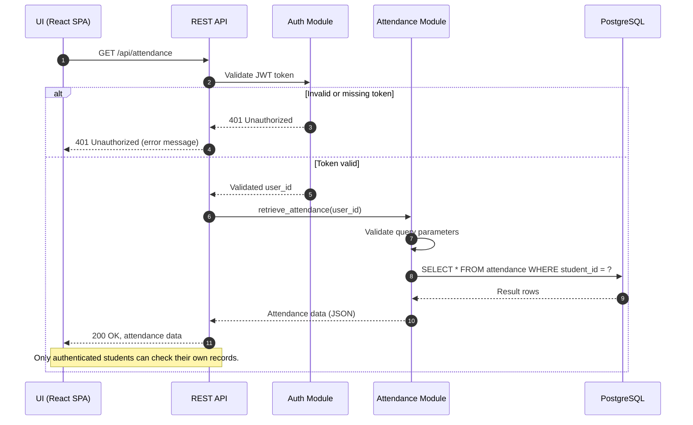

# Student Attendance Tracker

> Track your attendance effectively and efficiently.

A low-fidelity prototype of **Student Attendance Tracker**, generated by an agentic AI project manager from a stakeholder conversation in Slack.

## Screens

- [Home](index.html) — View the main dashboard and navigate to different features.
- [Track Attendance](track_attendance.html) — View and manage your attendance records.

## What this prototype fakes

- This prototype does not include backend functionalities.
- All interactions are simulated with static content.
- No actual user data is processed or stored.

## System design

### Use Case Diagram for Student Attendance Tracker

This use case diagram maps the single actor, Student, interacting with the application system boundary to check and view their attendance. The diagram places all use cases within a single "Attendance Management" subgraph, with supporting use cases like Sign In and Validate Attendance Request separated for modularity and separation of concerns. It includes the authentication provider as an external actor due to the login dependency. The simplicity of the system is intentional and tightly scoped: every node and edge reflects actual requirements for tracking and viewing attendance.

### Layered Architecture Diagram for Student Attendance Tracker

This architecture diagram defines the layered system design, including Client, Backend/API, Service modules, Data, and External services. The client layer runs a React SPA. API/backend is built on FastAPI, splitting into modules for profile, course, session, attendance, notification, authentication, input validation, audit logging, and monitoring. Service modules enable complex tasks (reminders, summaries, statistics) and interface with Celery for background jobs and Redis for caching. Data is held in PostgreSQL (primary), with Redis for cache and an object store reserved for exports. External providers handle both authentication and email notifications. Flows between layers are clearly labeled, with cross-module dependencies made explicit.

### Domain Entity-Relationship Diagram for Student Attendance Tracker

The ERD models all domain entities necessary for robust attendance tracking and reporting. Entities include STUDENT, COURSE, SESSION, ATTENDANCE, ENROLLMENT, AUDIT_LOG, and EMAIL_NOTIFICATION. There are many-to-many relationships between STUDENT and COURSE (via ENROLLMENT), SESSION and COURSE (each course has multiple sessions), and ATTENDANCE recording student presence for specific sessions. The schema enforces uniqueness and foreign key constraints for referential integrity, also supporting audit and notification history.

### Student Checks Attendance (End-to-End Flow)

This sequence diagram details the 'Check Attendance' process, which is the application's central flow. It walks through UI interaction, API invocation, JWT authentication, input validation, database query, and response, complete with error handling for unauthenticated access. Each participant corresponds to real implementation modules, and notes highlight business rules such as authentication and access control.

## Running it

Every file is static. Open `index.html`, or serve the directory with any static file server.
